# Board -- surrogate-models
record: local
open path: E-016   | blocked: 0 | todo roots: 4 | done: 505 | pruned: 101

## Tree

```text
E-016         [doing]    The section scripts keep each rule once and each shipped setting under test
  W-132  issue  [done]     One home for the family and unit macro tags   (filed during T-346) -- T-347 [done]
  W-143  issue  [done]     A Table refuses a row whose width differs from its columns   (filed during T-354) -- T-382 [done]
  W-144  issue  [done]     The shipped section settings are pinned by tests   (filed during T-359) -- T-383 [done]
  W-145  issue  [done]     One helper stores a section's tables and numbers   (filed during T-364) -- T-384 [done]
  W-147  issue  [todo]     Code comments and the citation notes name the sections the paper now has   (filed during T-373) -- T-388 [todo]
  W-157  issue  [done]     The figures mode of every section script is tested   (filed during T-398) -- T-422 [done]
  W-163  issue  [done]     The stable edge of a coupling pair is read from paperlib/domain.py alone   (filed during T-415) -- T-433 [done]
  W-166  bug    [todo]     A drifted section toml fails its pin test without naming the toml   (filed during T-383) -- T-437 [todo]
E-017         [todo]     The article is ready for the supervisors' read
  W-061  spike  [todo]     Which real references replace the placeholder citations -- T-118 [todo]
  W-129  bug    [todo]     A table caption above its table touches the top rule   (filed during T-336) -- T-341 [todo]
  W-164  issue  [todo]     Section 2.5 states the sampled neutron-star coupling ranges   (filed during T-419) -- T-435 [todo]
W-165  issue  [todo]     (standalone) The session context keeps headroom under the hook cap while a root burns -- T-436 [todo]
W-167  bug    [todo]     (standalone) The all-pairs parity figure of the baseline cannot be saved with LaTeX off   (filed during T-422) -- T-438 [todo]
W-168  issue  [todo]     (standalone) store_section's empty-tables and missing-numbers paths are pinned by tests   (filed during T-384) -- T-439 [todo]
```

## Closed

### E-001 [done] Overleaf-ready article built from the chapter folders

closed 2026-10-04 -- outcome: One command produces an Overleaf-ready article from the agreed skeleton, including assets generated by scripts. -- ledger: ledgers/E-001.md

#### W-001 issue [done] Skeleton article compiles from the chapter folders

- T-001 [done] Write the chapter skeleton and shared LaTeX setup -> 00_metadata/ and one <dir>/<dir>.tex per section
- T-002 [done] Add the paper layer -> mk/paper.mk compile builds build/paper/article/main.pdf

#### W-002 issue [done] A script beside its section generates an asset the article uses

- T-003 [done] Add the Python toolchain as a non-package project -> pyproject.toml, mk/python.mk, make check green
- T-004 [done] Write the build stamp script test-first -> 00_metadata/build_stamp.py with test_build_stamp.py
- T-005 [done] Wire generated assets into compile -> build stamp on the title page of main.pdf

#### W-003 issue [done] The article zip is a self-contained Overleaf project

- T-006 [done] Add the zip step -> build/paper/article.zip with main.tex at its root
- T-007 [done] Add the clean-room check -> make paper-verify compiles the unpacked zip

#### W-004 issue [done] build/paper/article/ is a clean upload folder

- T-008 [done] Move LaTeX residue out of the upload folder -> build/paper/article/ sources only, PDF at build/paper/article.pdf
- T-009 [done] Verify the upload folder in a clean room -> paper-verify compiles a copy of build/paper/article/

### E-002 [done] Data audit -- preprocessed datasets behind Sections 2 and 3

closed 2026-10-05 -- outcome: Preprocessed BH and NS tables, a frozen curve-grouped split, and the Section 3.1 numbers rendered from macros, all rebuilt by make from local/initial-data. -- ledger: ledgers/E-002.md

#### W-007 issue [done] BH table from the zero-phi0 dataset

- T-014 [done] Add data dependencies and the state home -> pandas + pyarrow, mk/data.mk STATE, CLAUDE.md gate deviation
- T-015 [done] Write the BH preparation test-first -> 30_physical_framework/32_black_holes/prepare_black_holes.py with its tests
- T-016 [done] Wire the BH preparation into make -> local/state/black_holes.parquet

#### W-008 spike [done] How neutron-stars.dat is laid out and how bad runs show up

- T-017 [done] Probe the NS file layout and failure signatures -> local/scratch/probe_neutron_stars.py and Findings on W-008
- T-018 [done] Decide the NS parsing and filtering rules -> spike.decision on W-008

#### W-009 issue [done] NS table from the filtered dataset

- T-019 [done] Write the NS preparation test-first -> 30_physical_framework/33_neutron_stars/prepare_neutron_stars.py with its tests
- T-020 [done] Wire the NS preparation into make -> local/state/neutron_stars.parquet

#### W-010 issue [done] Frozen split grouped by curve

- T-021 [done] Write the curve-grouped split test-first -> 50_methodology/51_algorithms/split_datasets.py with its tests
- T-022 [done] Wire the split into make with its invariant -> local/state/split.parquet, no curve in two sets

#### W-011 issue [done] Section 3.1 numbers from generated macros

- T-023 [pruned] Write the EDA numbers test-first -> 40_data_analysis/41_eda/eda_numbers.py with its tests   [pruned: superseded: W-017's eda_neutron_stars.py (and W-018's eda_black_holes.py) already generate every Section 3.1 and 3.2 number as macros]
- T-024 [pruned] Render Section 3.1 from the macros -> 41_eda.tex uses generated numbers and states the EDA scope   [pruned: superseded: Section 3.1 was rewritten from the nsEda macros in W-017 (T-054), developer-approved]

#### W-012 bug [done] BH parser fails on repeated block headers and blank lines   (filed during T-016)

- T-025 [done] Record the repeated-header case as a failing test -> test_prepare_black_holes.py RED
- T-026 [done] Skip repeated headers and blank lines in parse_table -> prepare_black_holes.py GREEN

#### W-019 spike [done] Which preprocessing, targets and split each dataset's EDA supports

- T-046 [done] Decide the NS decisions rows with the developer -> NS part of W-019 spike.decision
- T-047 [done] Decide the BH decisions rows with the developer -> BH part of W-019 spike.decision

#### W-020 issue [done] Section 4.3 preprocessing and feature decisions tables

- T-048 [done] Write the NS decisions table -> 40_data_analysis/43_preprocessing/43_preprocessing.tex
- T-049 [done] Write the BH decisions table -> 40_data_analysis/43_preprocessing/43_preprocessing.tex
- T-062 [done] Generate the Section 3.3 numbers test-first -> 40_data_analysis/43_preprocessing/preprocessing_numbers.py
- T-064 [done] Report raw M everywhere in the BH analysis -> eda_black_holes.py, Sections 3.2 and 3.3

#### W-025 bug [done] Two generated EDA tables overflow the text width   (filed during T-048)

- T-063 [done] Make the generated EDA tables fit the text width -> shared/eda.py booktabs and the table headers

#### W-026 issue [done] BH mass figure shows where the curves leave GR

- T-065 [done] Add the GR inset to the BH mass figure -> eda_black_holes.py and Section 3.2

### E-003 [done] Paper config, shared plot style and the per-dataset EDA figures

closed 2026-10-05 -- outcome: shared/plots.py and shared/config.py give a typed PaperConfig and one dataset-aware plot style; Section 4 holds an NS EDA, a BH EDA, a preprocessing-decisions and a hypotheses subsection; the NS and BH EDA scripts beside their sections write the figures paper.toml selects into build/assets, and make compile includes them. -- ledger: ledgers/E-003.md

#### W-013 issue [done] Section choices loaded from paper.toml

- T-027 [done] Add pydantic-settings -> pyproject.toml and uv.lock
- T-028 [done] Write the config loader test-first -> shared/config.py with shared/test_config.py
- T-029 [done] Write paper.toml with the plot and NS EDA sections -> paper.toml

#### W-014 issue [done] One paper-wide plot style with a color family per dataset

- T-030 [done] Add matplotlib and seaborn -> pyproject.toml and uv.lock
- T-031 [done] Write the plot style test-first -> shared/plots.py with shared/test_plots.py
- T-032 [pruned] Add the plot section and render a style sample -> paper.toml and local/scratch/style_sample.pdf   [pruned: replaced by the re-plan: the [plot] section moves into T-029 and the visual review happens on the NS and BH EDA figures (T-041, T-045), not a separate sample]

#### W-016 issue [done] Section 4 split into NS EDA, BH EDA, preprocessing decisions and hypotheses

- T-036 [done] Move the existing Section 4 subsections -> 40_data_analysis/41_neutron_stars and 44_hypotheses
- T-037 [done] Add the BH EDA and preprocessing subsections -> 40_data_analysis/42_black_holes and 43_preprocessing

#### W-017 issue [done] NS EDA figures and numbers selected in paper.toml

- T-038 [done] Write the NS EDA computations test-first -> 40_data_analysis/41_neutron_stars/eda_neutron_stars.py with its tests
- T-039 [done] Draw the NS EDA figures selected in paper.toml -> eda_neutron_stars.py figure functions and main
- T-040 [done] Wire the NS EDA into make and Section 4.1 -> mk/paper.mk rules and 41_neutron_stars.tex
- T-041 [done] Review the NS EDA figures with the developer -> Findings on W-017
- T-052 [done] Compare split strategies on the NS table test-first -> split_strategies in eda_neutron_stars.py
- T-053 [done] Add the NS tables and the extending figures selected in paper.toml -> eda_neutron_stars.py and shared/config.py
- T-054 [done] Write the NS insight paragraphs -> 40_data_analysis/41_neutron_stars/41_neutron_stars.tex

#### W-018 issue [done] BH EDA figures and numbers selected in paper.toml

- T-042 [pruned] Write the BH EDA computations test-first -> 40_data_analysis/42_black_holes/eda_black_holes.py with its tests   [pruned: superseded by the developer's re-plan of 2026-10-05: the shared EDA core is extracted first (T-055) and the BH computations are re-briefed to the BH-specific analysis (T-056)]
- T-043 [done] Draw the BH EDA figures selected in paper.toml -> eda_black_holes.py figure functions and main
- T-044 [done] Wire the BH EDA into make and Section 4.2 -> mk/paper.mk rules and 42_black_holes.tex
- T-045 [done] Review the BH EDA figures with the developer -> Findings on W-018
- T-055 [done] Extract the dataset-agnostic EDA core -> shared/eda.py with shared/test_eda.py
- T-056 [done] Write the BH EDA computations test-first -> 40_data_analysis/42_black_holes/eda_black_holes.py with its tests
- T-057 [done] Write the BH insight paragraphs -> 40_data_analysis/42_black_holes/42_black_holes.tex

#### W-022 bug [done] The NS EDA make rule targets a file the script no longer writes   (filed during T-044)

- T-058 [done] Point the NS EDA rule at its numbers file -> mk/paper.mk

#### W-023 bug [done] Python bytecode caches are tracked in git   (filed during T-057)

- T-059 [done] Untrack and delete the bytecode caches -> a tree without __pycache__

### E-004 [done] The paper builds for Overleaf upload and section-by-section review

closed 2026-10-06 -- outcome: build/assets/ grouped by section with each figure's PNG and wrapper sharing a stem; make overleaf filling build/paper/overleaf/ (flat, plus overleaf.zip) and listing the files added and removed since the last upload; make sections writing one PDF per section with references resolved through the full build; build/paper/article.pdf stays the whole paper. -- ledger: ledgers/E-004.md

#### W-031 issue [done] build/ grouped by section

- T-070 [done] Write each section's assets into its own folder test-first -> both EDA modules and preprocessing_numbers.py
- T-071 [done] Add make assets and move LaTeX residue to build/.work -> mk/paper.mk

#### W-032 issue [done] make overleaf keeps a drag-and-drop Overleaf project in sync

- T-072 [done] Diff the upload folder against the last upload test-first -> 00_metadata/overleaf_upload.py
- T-073 [done] Wire make overleaf -> mk/paper.mk, build/paper/overleaf/ and overleaf.zip

#### W-033 issue [done] One PDF per section with references resolved

- T-074 [done] Write the section entry files test-first -> 00_metadata/section_entry.py
- T-075 [done] Wire make section and make sections -> mk/paper.mk and build/paper/sections/

### E-005 [done] Baseline surrogate through one shared pipeline

closed 2026-10-07 -- outcome: make baseline fits the four dataset x target pairs with live per-epoch progress and writes the Section 5.1 baseline table (test and fold MARE beside the mean and nearest-curve references), the NS mass parity figure, the charge MARE rebuilt with the true and the predicted mass, and one diagnostics folder per run under local/state/51_algorithms/. -- ledger: ledgers/E-005.md

#### W-034 issue [done] NS mass baseline runs end to end with live feedback

- T-076 [done] Add torch and skorch -> pyproject.toml and uv.lock
- T-077 [done] Write the design-matrix contract test-first -> shared/design.py with shared/test_design.py
- T-078 [done] Write the estimator, metrics and training callbacks test-first -> shared/surrogate.py with shared/test_surrogate.py
- T-079 [done] Add the baseline settings to paper.toml -> a typed methodology section in shared/config.py
- T-080 [done] Write the baseline fit script and make baseline -> build/assets/51_algorithms/
- T-090 [done] Restore the best epoch's weights at early stopping -> shared/surrogate.py
- T-091 [done] Print the baseline error macros in scientific notation -> 50_methodology/51_algorithms/fit_baseline.py

#### W-035 issue [done] Each baseline run leaves a diagnostics folder

- T-081 [done] Write the run record test-first -> shared/runs.py with shared/test_runs.py
- T-082 [done] Write the loss curve and the error CDF test-first -> shared/diagnostics.py with shared/test_diagnostics.py
- T-083 [done] Write the worst and median curve overlays test-first -> shared/diagnostics.py
- T-084 [done] Wire the diagnostics into the baseline run -> local/state/51_algorithms/<run>/
- T-092 [done] Flag a run made from uncommitted code -> shared/runs.py and fit_baseline.py

#### W-036 issue [done] Baseline table for four pairs with fold scores and reference predictors

- T-085 [done] Write the reference predictors test-first -> shared/surrogate.py
- T-086 [done] Run the four pairs with fold scores -> build/assets/51_algorithms/51_algorithms_tab_baseline.tex
- T-087 [done] Add the four-pair baseline table to Section 5.1 -> 50_methodology/51_algorithms/51_algorithms.tex
- T-120 [done] Measure fit throughput by thread count and parallel fits -> a probe in local/scratch and a Finding on W-036
- T-121 [done] Train on one torch thread by default -> a threads setting in paper.toml and fit_baseline.py
- T-125 [done] Record W-063 and the re-plan of E-006 to E-008 -> .board/

#### W-037 issue [done] Charge rebuilt with the true and the predicted mass

- T-088 [done] Write the charge rebuild test-first -> shared/surrogate.py
- T-089 [done] Write the charge MARE with true and predicted mass -> 51_algorithms_num.tex and Section 5.1

#### W-054 issue [done] A running fit is visible live from the developer's terminal

- T-093 [done] Write each run's log to its folder -> <run>/train.log and latest.log
- T-094 [done] Log a fit progress line with elapsed and remaining time -> fit_baseline.py
- T-095 [done] Add make follow -> tail the running baseline's log

#### W-055 issue [done] Section 5.1 describes the pipeline and the NS mass baseline

- T-097 [done] Load the baseline numbers only when present -> 00_metadata/article.tex and 51_algorithms.tex
- T-098 [done] Write the Section 5.1 pipeline and baseline text -> 50_methodology/51_algorithms/51_algorithms.tex

#### W-056 issue [done] The epoch table names its time column elapse_s

- T-096 [done] Print the epoch time as elapse_s -> shared/surrogate.py

#### W-057 issue [done] A run tells how far it is, when it may stop and where its outputs go

- T-099 [done] Show k/MAX, epochs since best and the time-left range in the epoch table -> shared/surrogate.py
- T-100 [done] Log a start and an end banner for each run -> 50_methodology/51_algorithms/fit_baseline.py
- T-101 [done] Add make runs and make run -> 50_methodology/51_algorithms/list_runs.py and mk/paper.mk
- T-102 [done] Add make examples, the common commands with examples -> mk/paper.mk
- T-104 [done] Refine the run log from the developer's first look -> shared/surrogate.py and fit_baseline.py
- T-105 [done] Two stop-time columns, the stop criterion on top and a live loss curve -> shared/surrogate.py and fit_baseline.py
- T-106 [done] Print the epoch table at 4 significant figures, elapsed_s to a tenth -> shared/surrogate.py

#### W-062 issue [done] Section 4.1 lists the surrogate pipeline as an algorithm

- T-153 [done] Load the algorithm packages -> 00_metadata/preamble.tex
- T-154 [done] Typeset the pipeline as Algorithm 1 -> 50_methodology/51_algorithms/51_algorithms.tex

#### W-063 issue [done] The charge target keeps every charge, the floor dropped   (filed during T-086)

- T-122 [done] Drop the floor from the charge target test-first -> shared/design.py
- T-123 [done] Restate Section 3.3, H1 and the abstract without the floor -> 40_data_analysis/43_preprocessing/43_preprocessing.tex
- T-124 [done] Rerun the four pairs on the unfloored charge target -> build/assets/51_algorithms/51_algorithms_tab_baseline.tex
- T-147 [done] Checkpoint E-005 and restore the knowledge budget -> .board/board.toml

#### W-073 bug [done] The baseline table scores the charge on the log target, not on the charge D   (filed during T-089)

- T-151 [done] Score the charge rows in D test-first -> 50_methodology/51_algorithms/fit_baseline.py
- T-152 [done] Rerun the four pairs and restate the Section 4.1 comparison in D -> 50_methodology/51_algorithms/51_algorithms.tex

#### W-074 bug [done] The baseline table labels the charge rows Y although they score D   (filed during T-154)

- T-155 [done] Label the charge rows by D test-first -> 50_methodology/51_algorithms/fit_baseline.py
- T-156 [done] Rerun the four pairs with the D label -> build/assets/51_algorithms/51_algorithms_tab_baseline.tex

### E-006 [done] Search space and the best surrogate per dataset

closed 2026-11-11 -- outcome: For the two maps the paper learns -- black holes (beta, r_h) -> (M, D) and neutron stars (rho_c, beta, lambda) -> (M, D), one model per target, D rebuilt as M 10^Y -- make targets write the reachable relative error per dataset into Sections 3.1 and 3.2, score every candidate on one scorecard (significant figures at median, p95 and max per zone and per decade of D, ripple, fit and inference seconds at one thread), and end in Section 5's Pareto front naming the best approach per pair, with its extrapolation error against the distance from the training hull. -- ledger: ledgers/E-006.md

#### W-038 issue [pruned] rho_c input check -- raw against log10   [pruned: absorbed by the E-006 search-space re-plan (developer, 2026-10-07): rho_c input form becomes part of the S2 representation screen (W-066)]

#### W-039 issue [pruned] H1 -- log against linear charge target   [pruned: absorbed by the E-006 search-space re-plan (developer, 2026-10-07): log vs linear charge target becomes part of the S2 representation screen (W-066)]

#### W-040 issue [pruned] H2 -- loss x activation at the M_max turning point   [pruned: absorbed by the E-006 search-space re-plan (developer, 2026-10-07): loss x activation becomes part of S4-S5 tuning and precision (W-068)]

#### W-041 issue [pruned] H3a -- model pool GPR, XGBoost, MLP and ResNet   [pruned: absorbed by the E-006 search-space re-plan (developer, 2026-10-07): the model pool becomes the S3 family screen with interpolators added (W-067)]

#### W-042 issue [pruned] H3b -- ripple metric of MLP against ResNet   [pruned: absorbed by the E-006 search-space re-plan (developer, 2026-10-07): the ripple metric becomes a scorecard column for every model (W-065)]

#### W-043 issue [pruned] H3c -- GPR scaling wall   [pruned: absorbed by the E-006 search-space re-plan (developer, 2026-10-07): the GPR scaling wall becomes the data-budget axis of the S3 screen (W-067)]

#### W-064 issue [done] Sections 3.1 and 3.2 state the reachable relative error

- T-126 [done] Write the data-ceiling functions test-first -> shared/ceilings.py
- T-127 [done] Wire the ceilings into both EDA scripts -> 41_neutron_stars_num.tex and 42_black_holes_num.tex
- T-128 [done] Write paragraph 6 on the reachable error -> 41_neutron_stars.tex and 42_black_holes.tex

#### W-065 issue [done] One scorecard and a fair harness for every candidate

- T-129 [done] Write the scorecard test-first -> shared/scorecard.py
- T-130 [done] Write the fair harness test-first -> shared/harness.py
- T-131 [done] Move make baseline onto the harness -> build/assets/51_algorithms/51_algorithms_tab_baseline.tex
- T-146 [done] Describe the search procedure in Section 4.2 -> 50_methodology/52_optimization/52_optimization.tex
- T-169 [done] Correct the NS charge fold margin -> 50_methodology/51_algorithms/51_algorithms.tex

#### W-066 issue [done] Representation screen -- inputs, targets, pointwise or curve-wise

- T-132 [pruned] Add the curve-wise representation test-first -> shared/design.py   [pruned: split (developer, 2026-10-07): the target options into T-189, the curve-wise representation into T-190 as a harness fitter rather than a design]
- T-133 [done] Run the representation screen -> 60_results/61_representation/61_representation.tex
- T-189 [done] Add the target options test-first -> shared/design.py and shared/scorecard.py
- T-190 [done] Write the curve-wise fitter test-first -> shared/curvewise.py
- T-191 [done] Write the weighted k-NN and local-RBF fitters test-first -> shared/families.py
- T-192 [done] Let the harness take any target form -> shared/harness.py   (filed during T-189)
- T-198 [done] Point Section 3.1's rho_c todo at Section 5.1's result -> 40_data_analysis/41_neutron_stars/41_neutron_stars.tex   (filed during T-133)

#### W-067 issue [done] Family screen -- interpolators, GPR, XGBoost and networks

- T-134 [done] Write the family factories test-first -> shared/families.py
- T-135 [done] Run the family screen with successive halving -> 60_results/62_families/62_families.tex
- T-170 [done] Score every candidate's ripple through the harness -> shared/harness.py
- T-193 [done] Let the MLP fit several outputs test-first -> shared/surrogate.py   (filed during T-133)
- T-200 [done] Draw the family screen's parity plots test-first -> build/assets/62_families/62_families_fig_parity.png   (filed during T-135)
- T-201 [done] Draw the family screen's scaling figure test-first -> build/assets/62_families/62_families_fig_scaling.png   (filed during T-135)
- T-202 [done] Write the appendix on the model families -> 90_appendix/90_appendix.tex   (filed during T-135)

#### W-068 issue [done] Tuning and precision of the surviving families

- T-136 [done] Write the equal-budget search test-first -> shared/search.py
- T-137 [pruned] Write the precision regime test-first -> shared/surrogate.py   [pruned: re-planned (developer, 2026-10-09): the precision regime moves to W-093 so W-068 lands on the tuning table within the one-day branch]
- T-138 [pruned] Run tuning and precision on the survivors -> 60_results/63_precision/63_precision.tex   [pruned: re-planned (developer, 2026-10-09): the precision run moves to W-093 (T-211, T-212); W-068 closes on T-206's table]
- T-204 [done] Move the screen's candidate fitters to shared/ test-first -> shared/candidates.py   (filed during T-136)
- T-205 [done] Write the tuning run of the short list test-first -> 60_results/63_precision/tune_survivors.py   (filed during T-136)
- T-206 [done] Run the tuning of the short list -> build/assets/63_precision/63_precision_tab_tuning.tex   (filed during T-136)
- T-207 [done] Pin every search trial to one thread test-first -> shared/search.py   (filed during T-205)
- T-240 [done] Draw the tuning's search histories and searched ranges test-first -> 60_results/63_precision/tune_survivors.py   (filed during T-206)

#### W-069 issue [pruned] Extrapolation error against the distance from the training hull   [pruned: re-planned 2026-11-11 (developer): the paper never extrapolates beyond stable physical solutions; the domain guard replaces the extrapolation probe]

- T-139 [pruned] Write the distance from the training hull test-first -> shared/scorecard.py   [pruned: W-069 pruned: re-planned 2026-11-11 (developer): the paper never extrapolates beyond stable physical solutions; the domain guard replaces the extrapolation probe]
- T-140 [pruned] Run the extrapolation probe on the rim and outer curves -> 60_results/64_extrapolation/64_extrapolation.tex   [pruned: W-069 pruned: re-planned 2026-11-11 (developer): the paper never extrapolates beyond stable physical solutions; the domain guard replaces the extrapolation probe]

#### W-070 issue [pruned] Pareto front and the best approach per pair   [pruned: out of the paper path (developer, 2026-11-11): cost leaves the body and no solver exists to measure a speedup against]

- T-141 [pruned] Write the Pareto front test-first -> shared/scorecard.py   [pruned: W-070 pruned: out of the paper path (developer, 2026-11-11): cost leaves the body and no solver exists to measure a speedup against]
- T-142 [pruned] Run the budget comparison -> 60_results/65_budget/65_budget.tex   [pruned: W-070 pruned: out of the paper path (developer, 2026-11-11): cost leaves the body and no solver exists to measure a speedup against]
- T-143 [pruned] State the best approach per pair in the conclusion -> 80_conclusion/80_conclusion.tex   [pruned: W-070 pruned: out of the paper path (developer, 2026-11-11): cost leaves the body and no solver exists to measure a speedup against]

#### W-071 issue [done] Section 3.4 and Section 5 follow the search space

- T-144 [done] Rewrite Section 3.4 as the search-space question -> 40_data_analysis/44_hypotheses/44_hypotheses.tex
- T-145 [done] Rename and reorder the Section 5 folders -> 60_results/61_representation to 65_budget

#### W-075 spike [pruned] Can the surrogate predict the maximum neutron-star mass for given couplings   [pruned: absorbed (developer, 2026-11-11): Section 6 shows the predicted maximum mass]   (filed during T-131)

- T-157 [pruned] Measure the M_max ceiling across curves -> a probe in local/scratch and a Finding on W-075   [pruned: absorbed (developer, 2026-11-11): Section 6 shows the predicted maximum mass]
- T-158 [pruned] Compare the derived and the direct M_max on the held-out curves -> a probe in local/scratch and a Finding on W-075   [pruned: absorbed (developer, 2026-11-11): Section 6 shows the predicted maximum mass]
- T-159 [pruned] Decide how the surrogate predicts M_max with the developer -> the W-075 spike decision   [pruned: absorbed (developer, 2026-11-11): Section 6 shows the predicted maximum mass]

#### W-076 issue [done] Sections 3.1 and 3.2 state the data ceilings as absolute uncertainties   (filed during T-131)

- T-160 [done] Write the ceiling uncertainty macros test-first -> shared/ceilings.py
- T-161 [done] State the ceilings as uncertainties in paragraph 6 -> 41_neutron_stars.tex and 42_black_holes.tex

#### W-086 bug [done] The local RBF fails with a singular matrix when its neighbours span fewer than three curves   (filed during T-133)

- T-194 [done] Make the local RBF robust to a planar neighbourhood test-first -> shared/families.py

#### W-087 bug [done] The curve-wise fitter fails on a curve with fewer rows than spline coefficients   (filed during T-133)

- T-195 [done] Fit a short curve's spline by minimum-norm least squares test-first -> shared/curvewise.py

#### W-089 bug [done] ripple() scores a linear residual as rough on unevenly spaced curves   (filed during T-170)

- T-199 [done] Score the ripple by second divided differences test-first -> shared/scorecard.py

#### W-101 issue [pruned] The tuning prunes bad trials at fold boundaries and starts from the screen's settings   [pruned: out of the paper path (developer, 2026-11-11): a tuning cost optimization, and no new tuning is planned]   (filed during T-206)

- T-235 [pruned] Report the running fold mean and prune test-first -> shared/search.py and shared/trials.py   [pruned: W-101 pruned: out of the paper path (developer, 2026-11-11): a tuning cost optimization, and no new tuning is planned]
- T-236 [pruned] Enqueue the screen's settings as trial 0 and a grid for the GPR space test-first -> shared/search.py and tune_survivors.py   [pruned: out of the paper path (developer, 2026-11-11): a tuning cost optimization, and no new tuning is planned]

### E-007 [pruned] Ensemble uncertainty and the final surrogate

closed 2026-11-11 -- pruned: re-planned 2026-11-11 (developer): the guard is the physical domain, not an ensemble; the saved surrogate is W-152 -- ledger: ledgers/E-007.md

#### W-044 spike [pruned] Is L-BFGS fine-tuning worth keeping   [pruned: absorbed by the E-006 search-space re-plan (developer, 2026-10-07): L-BFGS becomes part of the S5 precision regime (W-068)]

#### W-045 issue [pruned] Ensemble uncertainty over curve-bootstrap resamples   [pruned: re-planned 2026-11-11 (developer): the guard is the physical domain, not an ensemble spread]

#### W-046 issue [pruned] Final surrogate saved and loadable   [pruned: absorbed (developer, 2026-11-11): make pipeline saves the loadable surrogates, without an ensemble]

### E-008 [pruned] Speedup and the MCMC application

closed 2026-11-11 -- pruned: MCMC is future work (E-013 Decision, confirmed by the developer 2026-11-11) -- ledger: ledgers/E-008.md

#### W-047 spike [pruned] Speedup baseline and reference posterior without the solver   [pruned: MCMC is future work (E-013 Decision, confirmed by the developer 2026-11-11)]

#### W-048 issue [pruned] Pareto front of error against inference time   [pruned: absorbed by the E-006 search-space re-plan (developer, 2026-10-07): the Pareto front of error against cost becomes S7 (W-070)]

#### W-049 issue [pruned] Mock MCMC recovery with emcee   [pruned: MCMC is future work (E-013 Decision, confirmed by the developer 2026-11-11)]

#### W-050 issue [pruned] Surrogate posterior validated against the reference   [pruned: MCMC is future work (E-013 Decision, confirmed by the developer 2026-11-11)]

### E-009 [done] The paper follows the revised structure, and the release

closed 2026-11-11 -- outcome: make compile builds build/paper/article.pdf under the new title, with Sections 2.1 to 2.4 written from the revised structure, every citation a refs.bib key, the remaining sections' outline bullets aligned to it, the abstract, introduction and conclusion written once the results exist, and the release scope decided. -- ledger: ledgers/E-009.md

#### W-051 issue [done] Sections 2.1 to 2.4 written from the revised structure

- T-109 [done] Add Section 2.2's folder and renumber the dataset sections -> 30_physical_framework/32_scalarization, 33_black_holes, 34_neutron_stars
- T-110 [done] Write Section 2.1, the action and field equations -> 30_physical_framework/31_action/31_action.tex
- T-111 [done] Write Section 2.2, the scalarization mechanism -> 30_physical_framework/32_scalarization/32_scalarization.tex
- T-112 [done] Write Section 2.3, the black-hole dataset -> 30_physical_framework/33_black_holes/33_black_holes.tex
- T-113 [done] Write Section 2.4, the neutron-star dataset -> 30_physical_framework/34_neutron_stars/34_neutron_stars.tex

#### W-053 spike [done] What the open-source release publishes

- T-119 [done] Write the code and data availability statement -> 00_metadata/metadata.tex and 80_conclusion/80_conclusion.tex

#### W-059 spike [done] Which refs.bib keys the revised structure's citations name

- T-107 [done] Map the numbered citations to refs.bib keys -> 00_metadata/citations.md
- T-108 [pruned] Add the missing references to refs.bib -> 00_metadata/refs.bib   [pruned: superseded: the real references move to the standalone spike W-061 (T-118); W-059 closes on placeholder keys (T-117)]
- T-117 [done] Cite placeholder entries for the missing references -> 00_metadata/refs.bib and the 13 cite markers

#### W-060 issue [done] Title and outline bullets aligned to the revised structure

- T-114 [done] Set the revised title -> 00_metadata/metadata.tex
- T-115 [done] Align the remaining outline bullets to the revised structure -> the todo bullets of 10, 20, 41, 44, 51-53, 61-64, 70, 80
- T-116 [done] Name paper sections by their compiled number in code and make -> mk/, paper.toml, the colocated modules

#### W-100 spike [pruned] What the paper claims once the search names its winners   [pruned: answered (developer, 2026-11-11): the thesis is the goal recorded as E-014's Decisions]   (filed during T-206)

- T-233 [pruned] List every claim of the title block, abstract, introduction, Section 3.4 and Section 7 against Section 5 -> Findings on W-100   [pruned: answered (developer, 2026-11-11): the thesis is the goal recorded as E-014's Decisions]
- T-234 [pruned] Decide the thesis with the developer and the supervisors -> the W-100 spike decision   [pruned: answered (developer, 2026-11-11): the thesis is the goal recorded as E-014's Decisions]

### E-010 [done] Every module meets the Python gates

closed 2026-10-11 -- outcome: make check passes with the audit gates closed and make assets representation families tuning rebuilds every file of build/assets byte-identical to the baseline hashes recorded at planning. -- ledger: ledgers/E-010.md

#### W-079 issue [done] Every test carries one category marker, registered and enforced   (filed during T-164)

- T-167 [done] Mark every test module with its category -> the test_*.py files
- T-168 [done] Register the markers and refresh the conftest from add-python -> pyproject.toml and conftest.py
- T-232 [done] Refresh mk/python.mk from add-python -> M= selection, test-integration, test-stats

#### W-091 issue [done] The screens' shared shell and test inputs live once -- one helper module, one toy fixture   (filed during T-205)

- T-213 [done] Write the run shell module test-first -> shared/batches.py
- T-214 [pruned] Point the four runnables at shared/batches.py -> no private copy of the run shell left   [pruned: its Check counts shared/batches.py, whose walled T-213's brief defines, and a test helper named walled, so it can never print 0; continued by the next Task with a runnables-only count]
- T-215 [done] Write the screens' toy tables once -> 60_results/conftest.py used by the three screen test modules
- T-282 [done] Write the ledger entry writer and reader once test-first -> shared/batches.py
- T-283 [done] Point the four runnables at shared/batches.py -> no private copy of the run shell left in a runnable

#### W-095 bug [done] The wall counts wall-clock time, so a sleeping laptop walls a healthy fit   (filed during T-206)

- T-219 [done] Arm the wall on the process's CPU time test-first -> shared/batches.py
- T-286 [done] Make the screens slow toy fitters compute instead of sleep -> the two screen tests

#### W-096 issue [done] One Pair and one FitRows value through the fit path   (filed during T-206)

- T-220 [done] Replace PAIRS and designs with a frozen Pair test-first -> shared/design.py and the four runnables
- T-221 [done] Replace the five-array Fitter with FitRows test-first -> shared/harness.py and its wrappers
- T-222 [done] Build Training through make_training and type the scorecard's maps as Mapping -> shared/surrogate.py, shared/scorecard.py

#### W-105 bug [done] make tuning with --recover on a partial batch fails at the figures after writing the table   (filed during T-240)

- T-242 [done] Read only the studies a batch's journal holds into the figures test-first -> 60_results/63_precision/tune_survivors.py   (filed during T-240)

#### W-106 issue [done] One vocabulary for pairs, units, families and labels

- T-243 [done] Define Unit, Family, curve_columns and PROFILE_BINS once -> shared/candidates.py, shared/search.py, shared/ceilings.py
- T-244 [pruned] Name the TeX form of a pair in one function test-first -> shared/design.py   [pruned: its pair_tex half landed in T-220 (W-096), and its check passes -q to make, which make reads as question mode (no output, exit 1); the target_symbol half is refiled as T-288 with a working check]
- T-245 [pruned] Pin one thread in one context manager test-first -> shared/harness.py   [pruned: its check passes -q to make, which make reads as question mode (no output, exit 1); refiled as T-289 with the same brief and a working check]
- T-246 [pruned] Configure worker logging once in the pool initializer test-first -> shared/workers.py   [pruned: its check passes -q to make, which make reads as question mode (no output, exit 1); refiled as T-290 with the same brief, its files by path and a working check]
- T-288 [done] Name a target plot symbol in one function test-first -> shared/design.py
- T-289 [done] Pin one thread in one context manager test-first -> shared/harness.py
- T-290 [done] Configure worker logging once in the pool initializer test-first -> shared/workers.py

#### W-107 issue [done] Asserts out of the domain, I/O out of the data modules

- T-247 [pruned] Build Symbols through make_symbols and read no file test-first -> shared/plots.py   [pruned: its check passes -q to make, which make reads as question mode (no output, exit 1); refiled as T-291 with the same brief and a working check]
- T-248 [pruned] Return NoCompletedTrial from search() test-first -> shared/search.py, 60_results/63_precision/tune_survivors.py   [pruned: its check passes -q to make, which make reads as question mode (no output, exit 1); refiled as T-292 with the same brief and a working check]
- T-249 [pruned] Narrow by match, not assert -> 60_results/63_precision/tune_survivors.py, 50_methodology/51_algorithms/fit_baseline.py   [pruned: its check passes -q to make, which make reads as question mode (no output, exit 1); refiled as T-293 with the same brief and a working check]
- T-291 [done] Build Symbols through make_symbols and read no file test-first -> shared/plots.py
- T-292 [done] Return NoCompletedTrial from search() test-first -> shared/search.py, 60_results/63_precision/tune_survivors.py
- T-293 [done] Narrow by match, not assert -> 60_results/63_precision/tune_survivors.py, 50_methodology/51_algorithms/fit_baseline.py

#### W-108 issue [done] Every knob has one home

- T-250 [done] Pass the probe and split knobs from make -> eda_neutron_stars.py, eda_black_holes.py, split_datasets.py, mk/data.mk, mk/paper.mk
- T-251 [pruned] Derive the short list from the screen batch test-first -> 60_results/63_precision/tune_survivors.py, mk/paper.mk   [pruned: its check passes -q to make, which make reads as question mode (no output, exit 1); refiled as T-294 with the same brief and a working check]
- T-252 [done] List the shared prerequisites by wildcard -> mk/paper.mk
- T-253 [done] Move the grid and dpi constants into PlotStyle test-first -> shared/plots.py, paper.toml, shared/eda.py, eda_neutron_stars.py, eda_black_holes.py, fit_baseline.py, shared/surrogate.py
- T-294 [done] Derive the short list from the screen batch test-first -> 60_results/63_precision/tune_survivors.py, mk/paper.mk

#### W-109 issue [done] Records, not tuples and dict blobs

- T-254 [pruned] Type the EDA records test-first -> eda_neutron_stars.py, eda_black_holes.py, shared/eda.py   [pruned: its check passes -q to make, which make reads as question mode (no output, exit 1); refiled as T-297 with the same brief and a working check]
- T-255 [pruned] Type the fit path records test-first -> 50_methodology/51_algorithms/fit_baseline.py, shared/runs.py   [pruned: its check passes -q to make, which make reads as question mode (no output, exit 1); refiled as T-298 with the same brief and a working check]
- T-256 [pruned] Type the maps as Mapping -> shared/ceilings.py, shared/runs.py, shared/search.py, 60_results/63_precision/tune_survivors.py   [pruned: its check counts every 4-space dict annotation, so the dict locals in tune_survivors.py (last, finished: there at filing) keep it above 0, and its Ceilings part was done by 4d3b718; refiled as T-300 with an AST check on class fields]
- T-297 [done] Type the EDA records test-first -> eda_neutron_stars.py, eda_black_holes.py, shared/eda.py
- T-298 [done] Type the fit path records test-first -> 50_methodology/51_algorithms/fit_baseline.py, shared/runs.py
- T-299 [done] Carry Epochs in RunMetadata test-first -> shared/runs.py, screen_representation.py, screen_families.py, tune_survivors.py, fit_baseline.py
- T-300 [pruned] Type the params and settings maps as Mapping -> shared/runs.py, shared/search.py, 60_results/63_precision/tune_survivors.py   [pruned: a placeholder filed by mistake while diagnosing a refused filing; the real Task is T-301]
- T-301 [done] Type the params and settings maps as Mapping -> shared/runs.py, shared/search.py, 60_results/63_precision/tune_survivors.py

#### W-110 issue [done] Module order, notation literals and the surrogate module

- T-257 [pruned] Reorder so main() is the last definition -> eda_neutron_stars.py, eda_black_holes.py, fit_baseline.py, screen_representation.py   [pruned: its check prints each file's whole last def line, so the one-line EDA main signatures and the wrapped ones give two lines, never the one it expects; refiled as T-302 with the check cut to the def main( prefix]
- T-258 [done] Move duration text and the reference predictors -> shared/progress.py, shared/families.py
- T-259 [done] Label through SYMBOLS test-first -> 40_data_analysis/41_neutron_stars/eda_neutron_stars.py, shared/plots.py
- T-302 [done] Reorder so main() is the last definition -> eda_neutron_stars.py, eda_black_holes.py, fit_baseline.py, screen_representation.py

#### W-117 bug [done] The NS numbers file is written in a run-dependent order, so a rebuilt asset need not match its hash   (filed during T-215)

- T-284 [pruned] Write the Figures macros in target order test-first -> shared/ceilings.py   [pruned: its check passes -q to make, which make reads as question mode: it prints nothing and exits 1 whatever the test does; superseded by T-285 with the same brief and a working check]
- T-285 [done] Write the Figures macros in target order test-first -> shared/ceilings.py (T-284 with a working check)

### E-011 [done] Figures and tables picked from rendered variants, numbers from macros

closed 2026-10-12 -- outcome: make variants writes every variant of every figure and table under build/variants/<section>/ with one contact sheet per asset, paper.toml records the pick per figure and table, make compile renders the picks, and Sections 4.1 to 5.3 and the appendix cite their numbers through macros. -- ledger: ledgers/E-011.md

#### W-102 issue [done] Every section's figures are selected in paper.toml   (filed during T-206)

- T-237 [done] Select the Section 5.2 figures in paper.toml -> shared/config.py, paper.toml, screen_families.py

#### W-104 bug [done] Section 5.2's error and scaling figures float past Section 5.3's text   (filed during T-240)

- T-241 [done] Keep Section 5.2's figures beside its text -> 60_results/62_families/62_families.tex   (filed during T-240)

#### W-111 issue [done] The variant mechanism on one figure

- T-260 [pruned] Add the mass_radius variant choice test-first -> shared/config.py, paper.toml   [pruned: its check passes -q to make, which is make's question mode: it runs no test and exits 1 (tried 2026-10-11), so it can never print 2 passed; re-filed with the same action and a working check]
- T-261 [pruned] Draw the departure and two-panel variants test-first -> 40_data_analysis/42_black_holes/eda_black_holes.py   [pruned: its check passes -q to make (question mode, runs nothing, exits 1), so it can never print 2 passed; re-filed with the same action and a working check]
- T-262 [done] Write the contact sheet and make variants test-first -> shared/plots.py, 40_data_analysis/42_black_holes/eda_black_holes.py, mk/paper.mk
- T-263 [pruned] Compile with the pick -> paper.toml, build/assets/42_black_holes/42_black_holes_fig_mass_radius.tex   [pruned: an environment override leaves the BH assets current, so make assets does not rerun and the check's grep finds nothing; its Output is an untracked build file the scope gate cannot close; re-filed as a test of main writing the picked variant]
- T-308 [done] Add the mass_radius variant choice test-first -> shared/config.py, paper.toml
- T-309 [done] Draw the departure and two-panel variants test-first -> 40_data_analysis/42_black_holes/eda_black_holes.py
- T-310 [done] Write the picked mass_radius variant into its wrapper test-first -> 40_data_analysis/42_black_holes/test_eda_black_holes.py, 40_data_analysis/42_black_holes/eda_black_holes.py

#### W-112 issue [done] Section 3 figure variants

- T-264 [pruned] Draw the NS charge_target and mass_density variants test-first -> eda_neutron_stars.py, shared/config.py, paper.toml, mk/paper.mk   [pruned: its check passes -q to make, which is make's question mode: it runs no test and exits 1, so it can never print its count (as T-260, 2026-10-11); its Action does not name every file of its title; re-filed with the same Action, a file list and a working check]
- T-265 [pruned] Draw the univariate and mass_max variants test-first -> eda_neutron_stars.py, eda_black_holes.py, shared/eda.py, shared/config.py, paper.toml   [pruned: its check passes -q to make, which is make's question mode: it runs no test and exits 1, so it can never print its count (as T-260, 2026-10-11); its Action does not name every file of its title; re-filed with the same Action, a file list and a working check]
- T-266 [pruned] Draw the BH charge_target and existence_edge variants test-first -> eda_black_holes.py, shared/config.py, paper.toml   [pruned: its check passes -q to make, which is make's question mode: it runs no test and exits 1, so it can never print its count (as T-260, 2026-10-11); its Action does not name every file of its title; re-filed with the same Action, a file list and a working check]
- T-267 [pruned] Draw the ceilings figure variants test-first -> shared/ceilings.py, eda_neutron_stars.py, eda_black_holes.py, shared/config.py, paper.toml   [pruned: its check passes -q to make, which is make's question mode: it runs no test and exits 1, so it can never print its count (as T-260, 2026-10-11); its Action does not name every file of its title; re-filed with the same Action, a file list and a working check]
- T-311 [done] Draw the NS charge_target and mass_density variants test-first -> eda_neutron_stars.py, shared/config.py, paper.toml, mk/paper.mk
- T-312 [done] Draw the univariate and mass_max variants test-first -> eda_neutron_stars.py, eda_black_holes.py, shared/eda.py, shared/config.py, paper.toml
- T-313 [done] Draw the BH charge_target and existence_edge variants test-first -> eda_black_holes.py, shared/config.py, paper.toml
- T-314 [done] Draw the ceilings figure variants test-first -> shared/ceilings.py, eda_neutron_stars.py, eda_black_holes.py, shared/config.py, paper.toml

#### W-113 issue [done] Section 4.1 and 5 figure variants

- T-268 [pruned] Draw the 4.1 parity variants test-first -> 50_methodology/51_algorithms/fit_baseline.py, shared/config.py, paper.toml, mk/paper.mk   [pruned: its check passes -q to make, which is make's question mode: it runs no test and exits 1, so it can never print its count (as T-260, 2026-10-11); its Action does not name every file it touches; re-filed with the same Action, a file list and a working check]
- T-269 [pruned] Draw the 5.2 errors and parity variants test-first -> 60_results/62_families/screen_families.py, shared/config.py, paper.toml, mk/paper.mk   [pruned: its check passes -q to make, which is make's question mode: it runs no test and exits 1, so it can never print its count (as T-260, 2026-10-11); its Action does not name every file it touches; re-filed with the same Action, a file list and a working check]
- T-270 [pruned] Draw the 5.2 scaling variants test-first -> 60_results/62_families/screen_families.py, shared/config.py, paper.toml   [pruned: its check passes -q to make, which is make's question mode: it runs no test and exits 1, so it can never print its count (as T-260, 2026-10-11); its Action does not name every file it touches; re-filed with the same Action, a file list and a working check]
- T-271 [pruned] Draw the 5.3 history and ranges variants test-first -> 60_results/63_precision/tune_survivors.py, shared/config.py, paper.toml, mk/paper.mk   [pruned: its check passes -q to make, which is make's question mode: it runs no test and exits 1, so it can never print its count (as T-260, 2026-10-11); its Action does not name every file it touches; re-filed with the same Action, a file list and a working check]
- T-315 [done] Draw the 4.1 parity variants test-first -> 50_methodology/51_algorithms/fit_baseline.py, shared/config.py, paper.toml, mk/paper.mk
- T-316 [done] Draw the 5.2 errors and parity variants test-first -> 60_results/62_families/screen_families.py, shared/config.py, paper.toml, mk/paper.mk
- T-317 [done] Draw the 5.2 scaling variants test-first -> 60_results/62_families/screen_families.py, shared/config.py, paper.toml
- T-318 [done] Draw the 5.3 history and ranges variants test-first -> 60_results/63_precision/tune_survivors.py, shared/config.py, paper.toml, mk/paper.mk

#### W-114 issue [done] Table layouts rendered to page images

- T-272 [pruned] Add the table layout choices and the aligned columns test-first -> shared/config.py, shared/eda.py, paper.toml, 00_metadata/preamble.tex   [pruned: its check passes -q to make, which runs no test (as T-260); its Action did not name the files it touches; the plan regenerated the table assets in build/assets with other layouts (they must stay the paper's) and a top-level [tables] block fails missing_section_folders; re-filed as T-321 to T-324 with a workable plan]
- T-273 [pruned] Rasterize each table layout through gs test-first -> 00_metadata/tables_entry.py, mk/paper.mk   [pruned: its check passes -q to make, which runs no test (as T-260); its Action did not name the files it touches; the plan regenerated the table assets in build/assets with other layouts (they must stay the paper's) and a top-level [tables] block fails missing_section_folders; re-filed as T-321 to T-324 with a workable plan]
- T-274 [pruned] Write the split and transposed results tables test-first -> screen_representation.py, screen_families.py, tune_survivors.py, fit_baseline.py   [pruned: its check passes -q to make, which runs no test (as T-260); its Action did not name the files it touches; the plan regenerated the table assets in build/assets with other layouts (they must stay the paper's) and a top-level [tables] block fails missing_section_folders; re-filed as T-321 to T-324 with a workable plan]
- T-275 [pruned] Select the decisions tables layout by macro test-first -> 40_data_analysis/43_preprocessing/43_preprocessing.tex, preprocessing_numbers.py, paper.toml   [pruned: its check passes -q to make, which runs no test (as T-260); its Action did not name every file it touches; re-filed as T-324]
- T-321 [done] Add the table layout choices and the aligned booktabs test-first -> shared/config.py, shared/eda.py, paper.toml, 00_metadata/preamble.tex
- T-322 [pruned] Rasterize every table in both layouts through gs test-first -> 00_metadata/tables_entry.py, mk/paper.mk   [pruned: its check needs the aligned layout to compile, which fails on a T-321 defect: _aligned_line in shared/eda.py splits header cells on ' & ', so the representation header ' & & Test & ...' loses a cell and Test reaches an S column unbraced (siunitx: Invalid number 'e'); the small layout rendered all 13 tables; re-filed as T-325 (the fix) and T-326 (this brief, unchanged) (developer, 2026-10-12)]
- T-323 [pruned] Write the split and transposed results tables test-first -> screen_representation.py, screen_families.py, tune_survivors.py, fit_baseline.py   [pruned: moved to W-124 at W-114's split (V22: T-325 took its slot; developer, 2026-10-12)]
- T-324 [pruned] Select the decisions tables layout by macro test-first -> 40_data_analysis/43_preprocessing/43_preprocessing.tex, preprocessing_numbers.py, paper.toml   [pruned: moved to W-124 at W-114's split (V22: T-325 took its slot; developer, 2026-10-12)]
- T-325 [done] Split the aligned table cells on every unescaped ampersand test-first -> shared/eda.py
- T-328 [done] Rasterize every table in both layouts through gs test-first -> 00_metadata/tables_entry.py, mk/paper.mk

#### W-115 issue [done] Two or three style presets on three figures

- T-276 [pruned] Read the marks from PlotStyle presets test-first -> shared/plots.py, paper.toml, the figure modules   [pruned: its check passes -q to make, which runs no test (E-011 finding); a 7-field Marks model cannot keep the paper preset byte-identical over 66 literals of about 22 distinct values; the developer chose scale factors (2026-10-12); re-filed as T-333]
- T-277 [pruned] Render three figures under each preset -> mk/paper.mk, build/variants/presets/presets_variants.png   [pruned: its Action named no entry script or test for the cross-preset sheet; re-filed as T-334 at W-115's activation]
- T-319 [done] Move the variant sheet writer into shared/plots.py test-first -> shared/plots.py, shared/test_plots.py
- T-333 [done] Scale the marks by the active PlotStyle preset test-first -> shared/plots.py, paper.toml, the figure modules
- T-334 [done] Render three figures under each preset -> 00_metadata/presets_sheet.py, mk/paper.mk, build/variants/presets/presets_variants.png

#### W-116 issue [done] Every result and knob the text cites has a generated macro

- T-278 [done] Write the knobs macro file from paper.toml and the make knobs test-first -> 00_metadata/paper_knobs.py, mk/paper.mk, 00_metadata/article.tex
- T-279 [pruned] Emit the representation and family result macros test-first -> 60_results/61_representation/screen_representation.py, 60_results/62_families/screen_families.py, 00_metadata/article.tex   [pruned: re-filed at the W-116 split (developer, 2026-10-12): its check passed -q to make, which runs nothing]
- T-280 [pruned] Emit the tuning result macros test-first -> 60_results/63_precision/tune_survivors.py, 00_metadata/article.tex   [pruned: re-filed at the W-116 split (developer, 2026-10-12): its check passed -q to make, which runs nothing]
- T-281 [pruned] Replace the literals in the text -> 51_algorithms.tex, 61_representation.tex, 62_families.tex, 63_precision.tex, 90_appendix.tex, preprocessing_numbers.py   [pruned: re-filed at the W-116 split (developer, 2026-10-12): the literals move to W-131]
- T-345 [done] Emit the representation and family result macros test-first -> 60_results/61_representation/screen_representation.py, 60_results/62_families/screen_families.py, 00_metadata/article.tex
- T-346 [done] Emit the tuning result macros test-first -> 60_results/63_precision/tune_survivors.py, 00_metadata/article.tex

#### W-122 bug [done] make compile keeps a figure a pick removed in build/paper/article.pdf   (filed during T-237)

- T-306 [done] Rerun latexmk when the assembled sources change -> mk/paper.mk
- T-307 [pruned] Recompile the paper with the shipped picks -> build/paper/article.pdf   [pruned: its Output build/paper/article.pdf is an untracked build file no commit carries, so the scope gate cannot close it (a brief defect at filing); its check was run and exited 0 -- make -W paper.toml families compile with the shipped picks, no undefined references -- and the 62_families assets match local/assets-baseline.sha]

#### W-124 issue [done] Per-table layouts rendered to page images   (filed during T-322)

- T-326 [pruned] Write the split and transposed results tables test-first -> screen_representation.py, screen_families.py, tune_survivors.py, fit_baseline.py   [pruned: five layouts over four modules plus a baseline rebuild and the per-table rendering in one Task; re-filed at W-124's activation as T-337 (representation), T-338 (families, tuning) and T-339 (baseline, rendering)]
- T-327 [done] Select the decisions tables layout by macro test-first -> 40_data_analysis/43_preprocessing/43_preprocessing.tex, preprocessing_numbers.py, paper.toml
- T-337 [done] Write the split and transposed representation tables test-first -> 60_results/61_representation/screen_representation.py
- T-338 [done] Write the rows-column family table and the no-screen and delta tuning tables test-first -> screen_families.py, tune_survivors.py
- T-339 [done] Rebuild the baseline tables without a fit and render every per-table layout -> fit_baseline.py, 00_metadata/tables_entry.py, mk/paper.mk

#### W-125 issue [done] Table page images cropped to the table   (filed during T-328)

- T-329 [done] Build the crop and rasterize commands test-first -> 00_metadata/tables_entry.py
- T-330 [done] Render the cropped table images -> build/variants/tables/

#### W-126 bug [done] The aligned table layout overflows the text width   (filed during T-328)

- T-331 [done] Set a table-format per aligned column test-first -> shared/eda.py
- T-332 [done] Confirm the aligned tables fit the text width -> build/.work/tables/aligned/flat/tables_aligned.log

#### W-127 bug [done] The aligned representation table mixes compact and subscript spreads   (filed during T-332)

- T-335 [done] Read a bold spread cell as a bold siunitx number test-first -> shared/eda.py, 00_metadata/preamble.tex
- T-336 [done] Word the representation caption per table layout test-first -> 60_results/61_representation/screen_representation.py

#### W-128 bug [done] The paper's baseline table is stale, written before its e-notation   (filed during T-339)

- T-340 [done] Rewrite the baseline table from the ledger in make assets -> mk/paper.mk

#### W-130 bug [done] The results tables reach the paper only through their own make targets   (filed during T-340)

- T-342 [done] Add the results tables with a recorded batch to the paper assets -> mk/paper.mk

#### W-131 issue [done] The text cites only macros, and a pick never leaves a dangling figure reference

- T-343 [done] Replace the literals in the text -> 51_algorithms.tex, 61_representation.tex, 62_families.tex, 63_precision.tex, 90_appendix.tex, preprocessing_numbers.py
- T-344 [done] Guard each pickable figure's reference -> 00_metadata/preamble.tex, 41_neutron_stars.tex, 42_black_holes.tex, 62_families.tex
- T-348 [done] Write the search-space bounds into the knobs macro file test-first -> 00_metadata/paper_knobs.py, 00_metadata/test_paper_knobs.py
- T-349 [done] Emit the tuning-journal analysis macros test-first -> 60_results/63_precision/tune_survivors.py, 60_results/63_precision/test_tune_survivors.py

#### W-133 bug [done] The 5.2 parity and error captions cite each other unguarded   (filed during T-344)

- T-350 [done] Guard the 5.2 captions' cross-references test-first -> 60_results/62_families/screen_families.py

### E-012 [done] Section modules, paperlib and standalone figures and tables

closed 2026-11-10 -- outcome: Each section folder is a module with its own make target, settings file and tests; shared code lives in the paperlib package; tables are typed objects stored in local/state and rendered from there; make figures and make tables write every variant as a standalone file under build/; make deliverable builds article.pdf throughout. -- ledger: ledgers/E-012.md

#### W-134 issue [done] shared/ and the paper-wide tools become the paperlib package

- T-351 [done] Add the assets comparison -> make assets-baseline and make assets-same in mk/paper.mk
- T-352 [done] Move shared/ into the package paperlib/ -> paperlib/ with every import rewritten
- T-353 [done] Move the tools and LaTeX includes of 00_metadata into paperlib -> paperlib/tools/ and paperlib/latex/
- T-381 [done] Sort the imports of the moved tool tests -> paperlib/tools/test_*.py pass ruff

#### W-135 issue [done] Tables are built as objects

- T-354 [done] Write the Table object and its renderer test-first -> paperlib/tables.py
- T-355 [done] Port the Section 3 tables to Table -> eda_neutron_stars.py, eda_black_holes.py, paperlib/ceilings.py
- T-356 [done] Port the methodology and results tables to Table -> fit_baseline.py and the three results scripts
- T-357 [done] Remove the string table renderer -> paperlib/eda.py without booktabs and its parsers

#### W-136 issue [done] One section builds on its own

- T-358 [done] Load the settings of a section from its own toml -> load_section in paperlib/config.py
- T-359 [done] Split paper.toml into the section settings files -> <section>/<section>.toml beside each script
- T-360 [done] Move the recipes of each section into its folder -> <section>/<section>.mk with a target named after the folder
- T-361 [done] Guard the section boundary -> a test that no section imports another

#### W-137 issue [done] Tables and numbers pass through local/state

- T-362 [done] Store a Table as JSON -> to_json and from_json in paperlib/tables.py
- T-363 [done] Render stored tables and numbers into assets -> paperlib/tools/render_assets.py
- T-364 [done] Hand the Section 3 tables and numbers through local/state -> 41, 42 and 43 write JSON, render_assets writes the assets
- T-365 [done] Hand the methodology and results tables and numbers through local/state -> 51, 61, 62 and 63 write JSON
- T-385 [done] Keep the table and preset variants running -> mk/paper.mk passes --state and renders the stored tables

#### W-138 issue [done] Every figure variant is its own file under build/figures

- T-366 [done] Draw every Section 3 figure variant as its own file -> a figures mode in eda_neutron_stars.py and eda_black_holes.py
- T-367 [done] Draw every methodology and results figure variant as its own file -> a figures mode in fit_baseline.py, screen_families.py and tune_survivors.py
- T-368 [done] Remove the contact sheets -> paperlib/plots.py without contact_sheet, the presets as standalone files
- T-369 [done] Wire make figures and the picks of the paper -> a figures target in mk/paper.mk, the paper includes build/figures
- T-387 [done] Write the parity wrapper on every 5.1 rebuild -> fit_baseline.py --tables writes the picked wrapper and drops the stale parity PNG

#### W-139 issue [done] Every table layout and shape is its own file under build/tables

- T-370 [done] Turn the table shapes into functions over Table -> one Table -> Table function per shape in the four scripts
- T-371 [done] Render every table layout and shape as a standalone PDF -> paperlib/tools/table_pages.py and make tables
- T-372 [done] Remove the table environment overrides -> no PAPER__TABLES__ left, table-variants gone

### E-013 [done] The paper tells the physics, the data science is the appendix

closed 2026-11-11 -- outcome: article.pdf follows the outline agreed on 2026-11-10: 1 Introduction, 2 Physical framework with the domain boundaries, 3 The surrogate pipeline, 4 Out-of-domain filter and feedback, 5 Results, 6 Physical implications, 7 Conclusion with MCMC as future work; the appendix holds the exploratory analysis, the preprocessing, the search and the model families; the abstract, introduction and conclusion outlines state the pipeline goal. -- ledger: ledgers/E-013.md

#### W-140 issue [done] The data-science subsections become the appendix

- T-373 [done] Move the Section 3 folders into the appendix -> 90_appendix/91_neutron_stars to 94_hypotheses
- T-374 [done] Move the methodology and results subsections into the appendix -> 90_appendix/95_algorithms to 99_precision
- T-375 [done] Finish the appendix entry -> 90_appendix.tex opens the appendix, the model families join 98_families

#### W-141 issue [done] The body follows the agreed outline

- T-376 [done] Write the new body sections as outlines -> 35_domain_boundaries, 40_pipeline, 50_validity, 70_discussion
- T-377 [done] Fold MCMC into the conclusion and group the results by dataset -> 80_conclusion.tex future work, 60_results 61 to 64, 70_mcmc removed

#### W-142 issue [done] The abstract, introduction and conclusion outlines state the pipeline goal

- T-378 [done] Rewrite the abstract outline -> 10_abstract/10_abstract.tex states the pipeline goal
- T-379 [done] Rewrite the introduction outline -> 20_introduction/20_introduction.tex contributions name the pipeline
- T-380 [done] Rewrite the conclusion outline -> 80_conclusion/80_conclusion.tex summarizes the pipeline

### E-014 [done] One pipeline, two maps -- the data ceiling inside the physical domain

closed 2026-11-12 -- outcome: article.pdf is a short physics-first paper -- the framework, the pipeline as an algorithm, the domain of validity, the results on both maps, their physical implications -- with the data science in the appendix; every section is a module that make rebuilds on its own into build/sections/<section>/, the interim results under local/state/, the root make layer configuration only. -- ledger: ledgers/E-014.md

#### W-052 issue [done] The body is written: domain edges, pipeline, abstract, introduction and conclusion

- T-418 [done] Trim the results to the two maps -> 60_results without 63_extrapolation and 64_cost
- T-419 [done] Write the physical edges of the domains -> 30_physical_framework/35_domain_boundaries/35_domain_boundaries.tex
- T-420 [done] Write the pipeline as an algorithm -> 40_pipeline/41_algorithm/41_algorithm.tex and 40_pipeline/42_error_metric/42_error_metric.tex
- T-421 [done] Write the abstract, introduction and conclusion -> 10_abstract, 20_introduction and 80_conclusion
- T-434 [done] Retitle the body sections -> the section lines of 30_physical_framework, 40_pipeline, 60_results and 80_conclusion

#### W-093 issue [done] Precision regime on the tuned short list   (filed during T-206)

- T-209 [pruned] Fit one candidate on one pair -> make fit P= C= U= prints its scorecard   [pruned: superseded by W-152: make pipeline (40_pipeline/41_algorithm/build_surrogates.py) already fits and scores each pair winner in minutes, and the precision run reads its local/state/41_algorithm/summary.json; the extrapolation probe and budget comparison it was the skeleton for left with E-013; its one-pair smoke run is folded into the precision run as --pair / PRECISION_PAIRS (coordinator re-brief, 2026-11-11)]
- T-210 [done] Write the residual stage and the option table test-first -> 90_appendix/99_precision/precision_options.py
- T-211 [done] Write the precision run test-first -> 90_appendix/99_precision/precision_regime.py and make precision
- T-212 [done] Run the precision regime on the saved surrogates -> build/sections/99_precision/99_precision_fig_precision.tex
- T-427 [done] Narrow the tuning run sweep to its own stems -> 90_appendix/99_precision/tune_survivors.py
- T-430 [done] Name the precision macros with letters only -> 90_appendix/99_precision/precision_regime.py

#### W-150 issue [done] Each section's artifacts build under build/sections

- T-396 [done] Remove the standalone table pages -> mk/paper.mk without the tables target
- T-397 [done] Write each section's assets under build/sections -> ASSETS is build/sections
- T-398 [done] Draw each section's figure variants beside its assets -> build/sections/<section>/figures/
- T-399 [done] Compile the section previews beside the section artifacts -> build/sections/<section>/<section>.pdf

#### W-151 issue [done] The root make layer holds configuration only

- T-400 [done] Move the preset figures into the sections that draw them -> 91_neutron_stars.mk, 98_families.mk and 99_precision.mk
- T-401 [done] Hand the cited knobs from each screen's own .mk -> mk/paper.mk names no section

#### W-152 issue [done] make pipeline builds and saves the surrogate of each map and target

- T-402 [done] Store the audit's reachable figures as data -> local/state/91_neutron_stars/reachable_figures.json and local/state/92_black_holes/reachable_figures.json
- T-403 [done] Store the tuning's winners as data -> local/state/99_precision/winners.json
- T-404 [done] Save and load a fitted surrogate -> paperlib/final.py
- T-405 [done] Run the pipeline for every pair -> 40_pipeline/41_algorithm/build_surrogates.py and make pipeline
- T-426 [done] Skip winners.json when a test reads the saved batch -> 90_appendix/99_precision/test_tune_survivors.py

#### W-153 issue [done] The surrogate refuses an input outside the physical domain, shown in Section 4

- T-406 [done] Model the physical domain of each map -> paperlib/domain.py
- T-407 [done] Guard the saved surrogates with their domain -> paperlib/final.py predict
- T-408 [done] Draw Section 4's domain figure -> 50_validity/check_domain.py and make 50_validity
- T-409 [done] Write Section 4 as the domain of validity -> 50_validity/50_validity.tex
- T-432 [done] Move the domain figure legend off the panels -> 50_validity/check_domain.py

#### W-154 issue [done] Section 5.1 shows the black-hole surrogates against the data ceiling

- T-410 [done] Score a saved surrogate row by row on the held-out curves -> paperlib/final.py held_out_errors
- T-411 [done] Draw Section 5.1's error figure -> 60_results/61_black_holes/results_black_holes.py and make 61_black_holes
- T-412 [done] Write Section 5.1 -> 60_results/61_black_holes/61_black_holes.tex

#### W-155 issue [done] Section 5.2 shows the neutron-star surrogates against the data ceiling

- T-413 [done] Draw Section 5.2's error figure -> 60_results/62_neutron_stars/results_neutron_stars.py and make 62_neutron_stars
- T-414 [done] Write Section 5.2 -> 60_results/62_neutron_stars/62_neutron_stars.tex

#### W-156 issue [done] Section 6 shows the maximum neutron-star mass the surrogate predicts

- T-415 [done] Predict the maximum mass of each held-out curve -> 70_discussion/mass_max.py
- T-416 [done] Draw Section 6's maximum-mass figure -> make 70_discussion
- T-417 [done] Write Section 6 -> 70_discussion/70_discussion.tex

### E-015 [done] A clean checkout rebuilds the four surrogates as they were tuned

closed 2026-11-12 -- outcome: make pipeline and make precision rebuild the four tuned surrogates from a clean checkout: a full run after a smoke run fits every pair, the pipeline reads the tuning's own knobs, cloudpickle is declared, and a saved curve-wise surrogate predicts as fitted. -- ledger: ledgers/E-015.md

#### W-158 issue [done] cloudpickle is a declared dependency of the project   (filed during T-404)

- T-423 [done] Declare cloudpickle as a dependency -> pyproject.toml

#### W-159 issue [done] A saved curve-wise surrogate predicts as fitted   (filed during T-404)

- T-424 [done] Test the curve-wise round trip of a saved surrogate -> paperlib/test_final.py

#### W-160 issue [done] make pipeline takes its knobs from the tuning's own knobs   (filed during T-405)

- T-425 [done] Read the pipeline knobs from TUNING_KNOBS -> 40_pipeline/41_algorithm/41_algorithm.mk
- T-431 [done] Name the saved domains in the pipeline header -> 40_pipeline/41_algorithm/41_algorithm.mk

#### W-161 bug [done] make precision after a one-pair smoke run skips the full run as current   (filed during T-212)

- T-428 [done] Make the precision rule depend on PRECISION_PAIRS -> 90_appendix/99_precision/99_precision.mk

### W-005 issue [done] (standalone) Python layer follows the COLOCATED level

closed 2026-10-04 -- outcome: Given the COLOCATED mechanics of \~/.claude/rules/python.md, When make check runs, Then it passes with the repository root on pytest pythonpath and the python files matching the add-python COLOCATED templates. -- ledger: ledgers/W-005.md

- T-010 [done] Put the repository root on pytest pythonpath -> pyproject.toml pythonpath = ["."]
- T-011 [done] Align the python files with the add-python COLOCATED templates -> pyproject.toml, mk/python.mk, conftest.py

### W-006 issue [done] (standalone) Python dependencies resolve CPU-only for this machine

closed 2026-10-04 -- outcome: Given pyproject.toml, When torch is added with uv, Then it resolves from https://download.pytorch.org/whl/cpu and the lock holds no nvidia, CUDA or triton package. -- ledger: ledgers/W-006.md

- T-012 [done] Pin torch to the PyTorch CPU index -> pyproject.toml [[tool.uv.index]] and [tool.uv.sources]
- T-013 [done] Prove torch resolves CPU-only -> a scratch copy of pyproject.toml locks torch +cpu with no GPU packages

### W-015 issue [done] (standalone) Paper text for the D floor and the sign symmetry of D

closed 2026-10-05 -- outcome: Given the E-002 D-floor and sign-symmetry Decisions and the Section 3.1 macros, When make compile runs, Then H1, the EDA D bullet and Section 2 state the floor eps, the share of rows below it and the D -> -D symmetry, with no hard-coded number. -- ledger: ledgers/W-015.md

- T-033 [done] Add the D-floor macros -> eps and the share below it in the Section 3.1 macro output
- T-034 [done] Restate H1 and the EDA D bullet for the floor -> 42_hypotheses.tex, 41_eda.tex, 61_h1.tex
- T-035 [done] State the sign symmetry of D in Section 2 -> 30_physical_framework/31_action/31_action.tex

### W-021 issue [done] (standalone) Review markers in the paper with todonotes

closed 2026-10-05 -- outcome: Given the preamble with todonotes, When make compile runs, Then every \todo and every \review note renders inline in its own colour and the upload folder compiles on its own. -- ledger: ledgers/W-021.md

- T-050 [done] Replace the hand-made todo macro with todonotes -> 00_metadata/preamble.tex
- T-051 [done] Add the review note kind and mark the open claims -> preamble.tex and the review notes

### W-024 issue [done] (standalone) Runtime state follows the global local/state rule

closed 2026-10-05 -- outcome: Given the base Makefile with STATE and no local/state Gate deviation, When make clean and then make data run, Then make data rebuilds no state file. -- ledger: ledgers/W-024.md

- T-060 [done] Move STATE into the base Makefile -> Makefile and mk/data.mk
- T-061 [done] Remove the local/state Gate deviation -> CLAUDE.md

### W-027 issue [done] (standalone) make clean runs every area clean, the state included

closed 2026-10-05 -- outcome: Given local/initial-data and a built local/state, When make clean runs, Then local/state is gone and local/initial-data is untouched. -- ledger: ledgers/W-027.md

- T-066 [done] Adopt the area cleans -> Makefile, mk/python.mk and mk/data.mk

### W-028 issue [done] (standalone) Outline text cites stale charge and row numbers

closed 2026-10-05 -- outcome: Given the generated EDA and preprocessing macros, When make compile runs, Then the abstract and Section 2.3 cite the charge range and row counts only through generated macros. -- ledger: ledgers/W-028.md

- T-067 [done] Cite the generated numbers in the abstract and Section 2.3 -> 10_abstract.tex and 33_neutron_stars.tex

### W-029 issue [done] (standalone) Figures render as high-resolution PNG

closed 2026-10-05 -- outcome: Given paper.toml with plot.dpi, When make compile runs, Then every selected EDA figure reaches the PDF as a PNG written at that resolution. -- ledger: ledgers/W-029.md

- T-068 [done] Write the EDA figures as PNG at plot.dpi -> shared/plots.py, both EDA modules, paper.toml

### W-030 issue [done] (standalone) Figures at 450 dpi to keep the paper small

closed 2026-10-05 -- outcome: Given paper.toml with plot.dpi = 450, When make compile runs, Then the figures in build/assets are PNGs written at 450 dpi. -- ledger: ledgers/W-030.md

- T-069 [done] Set plot.dpi to 450 -> paper.toml

### W-058 issue [done] (standalone) Landing settings follow the board tool of 2026-10-06

closed 2026-10-06 -- outcome: Given the board skill's current [landing] keys, When the developer runs make board-status, Then the landing line prints with no [WARN]. -- ledger: ledgers/W-058.md

- T-103 [done] Review [landing] and record the worktree decision -> .board/board.toml

### W-072 spike [done] (standalone) Should fits run as parallel tracked trials, and should Optuna be the registry

closed 2026-10-07 -- outcome: Given a throughput probe of k one-thread fits and an Optuna-storage prototype of one screen, When the developer weighs them, Then the parallelism and the run registry are decided on this spike. -- ledger: ledgers/W-072.md

- T-148 [done] Measure the throughput of k one-thread fits -> a probe in local/scratch and a Finding on W-072
- T-149 [done] Prototype Optuna storage as the run registry -> a probe in local/scratch and a Finding on W-072
- T-150 [done] Decide the parallelism and the run registry with the developer -> the W-072 spike decision

### W-077 issue [done] (standalone) Every harness run leaves a record in the run ledger

closed 2026-10-07 -- outcome: Given a screen run through the harness, When the developer runs make ledger, Then every fit of it appears as one row with its candidate, settings, seed, fold and test significant figures and fit seconds. -- ledger: ledgers/W-077.md

- T-162 [done] Write the ledger entry test-first -> shared/runs.py
- T-163 [done] Save every harness run to the ledger -> shared/harness.py and fit_baseline.py
- T-164 [done] List the ledger as a table -> make ledger

### W-078 issue [done] (standalone) Console numbers read as orders of magnitude -- errors, losses and lr in e-notation

closed 2026-10-07 -- outcome: Given a fit through make_estimator, When its epoch table is logged, Then every loss, error and lr cell is in e-notation of one width per column. -- ledger: ledgers/W-078.md

- T-165 [pruned] Format the epoch table per column -> shared/surrogate.py   [pruned: its check (-k epoch_table, 4 passed) also selects the existing test_the_epoch_table_reaches_the_logger, so it prints 5 passed when the Output exists; refiled as T-172 with the TestEpochTable node id]
- T-166 [pruned] Put the other console numbers on the same rule -> banners, progress lines, run listings   [pruned: refuted by its review: every console error, loss and MARE in shared/ and 50_methodology/ is already .2e (list_runs.py:54, fit_baseline.py:345 end banner, list_ledger.py:38); the other float lines are durations, counts and figures, which stay; nothing to change, and its check would pass only on T-172's test name]
- T-172 [done] Format the epoch table per column -> shared/surrogate.py
- T-173 [done] Keep tabulate from re-formatting the epoch cells -> shared/surrogate.py   (filed during T-172)
- T-174 [done] Rename T-172's test class so it stops shadowing TestEpochTable -> shared/test_surrogate.py   (filed during T-173)
- T-175 [done] Keep floatfmt .4g on the columns EpochTable leaves to skorch -> shared/surrogate.py   (filed during T-174)
- T-176 [done] Declare tabulate as a direct dependency -> pyproject.toml and uv.lock   (filed during T-173)
- T-177 [done] Format the lr column by its history key event_lr -> shared/surrogate.py   (filed during T-166)

### W-080 bug [done] (standalone) Task checks run outside make leave __pycache__ in the tree and mark runs dirty

closed 2026-10-07 -- outcome: Given a clean tree, When a Task check runs uv run pytest outside make, Then git status --short prints nothing. -- ledger: ledgers/W-080.md

- T-171 [done] Ignore __pycache__ in git -> .gitignore

### W-081 issue [done] (standalone) Harness fits run on six workers as trials of an Optuna study, followed live

closed 2026-10-07 -- outcome: Given make baseline with six workers, When it runs, Then make dashboard shows every fit of the run as a live trial of one study. -- ledger: ledgers/W-081.md

- T-178 [done] Write the trial bridge test-first -> shared/trials.py
- T-179 [done] Run jobs on k one-thread workers test-first -> shared/workers.py
- T-180 [done] Run make baseline on workers as trials, and make dashboard -> fit_baseline.py and mk/paper.mk
- T-181 [done] Count a trial's reported steps across its fits -> shared/trials.py   (filed during T-180)
- T-182 [done] Give network_fitter a hook before each fit -> shared/surrogate.py   (filed during T-180)
- T-183 [done] Open a study on a journal file, created or joined -> shared/trials.py   (filed during T-180)
- T-185 [done] Name a running trial by its pair and candidate -> fit_baseline.py   (filed during T-180)

### W-082 bug [done] (standalone) Format drift goes unnoticed -- make check runs ruff check but not ruff format --check

closed 2026-10-07 -- outcome: Given a tracked python file that ruff format would rewrite, When make check runs, Then it fails naming the file. -- ledger: ledgers/W-082.md

- T-184 [done] Check the format in make check, and format the drifted files -> mk/python.mk and the three files

### W-083 issue [done] (standalone) make baseline's console carries no Optuna chatter

closed 2026-10-07 -- outcome: Given a make baseline run, When it prints to the console, Then no Optuna INFO line appears. -- ledger: ledgers/W-083.md

- T-186 [done] Lower Optuna's verbosity to warnings in every process -> shared/trials.py

### W-084 bug [done] (standalone) make baseline's console never says how to follow the run

closed 2026-10-07 -- outcome: Given a make baseline run, When it starts, Then its console names make dashboard. -- ledger: ledgers/W-084.md

- T-187 [done] Log main's own lines at the configured level -> fit_baseline.py

### W-085 bug [done] (standalone) A trial finished from outside kills the whole make baseline run

closed 2026-10-07 -- outcome: Given a running trial finished from outside, When its job reports the next epoch, Then the fit continues and the run ends with every ledger entry. -- ledger: ledgers/W-085.md

- T-188 [done] Treat a trial finished elsewhere as a closed view -> shared/trials.py

### W-088 issue [pruned] (standalone) A running representation screen is followable -- progress, time left and each entry's representation

closed 2026-11-11 -- pruned: out of the paper path (developer, 2026-11-11): screen tooling, and no new screen is planned -- ledger: ledgers/W-088.md

- T-196 [pruned] Log the screen's jobs done and time left test-first -> 60_results/61_representation/screen_representation.py   [pruned: out of the paper path (developer, 2026-11-11): screen tooling, and no new screen is planned]
- T-197 [pruned] Show each ledger entry's representation test-first -> 50_methodology/51_algorithms/list_ledger.py   [pruned: out of the paper path (developer, 2026-11-11): screen tooling, and no new screen is planned]

### W-090 bug [done] (standalone) Citing SciPy2020 stops the paper build -- a math accent in refs.bib

closed 2026-10-08 -- outcome: Given a section that cites SciPy2020, When make compile runs, Then the paper PDF builds. -- ledger: ledgers/W-090.md

- T-203 [done] Write SciPy2020's accent in text mode -> 00_metadata/refs.bib

### W-092 bug [done] (standalone) make dashboard opens the baseline journal, never the journal of a running screen or tuning batch

closed 2026-10-09 -- outcome: Given a tuning batch writing its journal under $(STATE)/63_precision/, When the developer runs make dashboard, Then optuna-dashboard opens that batch's journal. -- ledger: ledgers/W-092.md

- T-208 [done] Point make dashboard at the newest study journal -> mk/paper.mk   (filed during T-206)

### W-094 bug [done] (standalone) A trial that raises ends the tuning after every other job and leaves no outcomes file

closed 2026-10-10 -- outcome: Given a tuning whose one trial raises, When make tuning runs on a toy batch, Then it ends with every job's outcome in <state>/63_precision/<batch>.json and the raising trial marked FAIL in the journal. -- ledger: ledgers/W-094.md

- T-216 [done] Tell a raising trial FAIL test-first -> shared/search.py
- T-217 [done] Save the outcomes after each job test-first -> 60_results/63_precision/tune_survivors.py
- T-218 [done] Rebuild a batch's outcomes from its ledger and journal test-first -> tune_survivors.py --recover

### W-097 bug [done] (standalone) Three generated assets overflow the page in the compiled paper

closed 2026-10-09 -- outcome: Given the generated assets, When make compile runs, Then no generated asset overflows its page. -- ledger: ledgers/W-097.md

- T-223 [done] Cap a multi-row figure at a share of the text height test-first -> shared/plots.py and screen_families.py
- T-224 [done] Fit the baseline table to the text width -> 50_methodology/51_algorithms/fit_baseline.py
- T-225 [done] Draw the NS ceilings in the NS colour family test-first -> 40_data_analysis/41_neutron_stars/eda_neutron_stars.py
- T-226 [pruned] Fail paper-verify on a float or overfull warning from a generated asset -> 00_metadata/latex_warnings.py and mk/paper.mk   [pruned: excessive (developer, agreed with \~/.claude's session): a pdfTeX log parser with its own suite tests the typesetter's output, the class of proving the PDF opens; W-097's criterion keeps the behaviour, the grep of the log is the evidence at its close]
- T-239 [done] Adapt the charge-row macro test to the seven-column table -> 50_methodology/51_algorithms/test_fit_baseline.py   (filed during T-225)

### W-098 issue [done] (standalone) Figures and captions share the paper's notation

closed 2026-10-10 -- outcome: Given the notation macros in 00_metadata/notation.tex, When make assets runs, Then every figure label is typeset through text.latex.preamble from that file and no figure module defines a dict of hand-spelled symbols. -- ledger: ledgers/W-098.md

- T-227 [done] Move the notation macros to 00_metadata/notation.tex -> preamble.tex inputs it
- T-228 [done] Hand the notation to matplotlib through text.latex.preamble test-first -> shared/plots.py
- T-229 [done] Replace the hand-spelled symbol dicts with the macros -> the four figure modules

### W-099 issue [done] (standalone) make deliverable builds the paper PDF and proves it opens

closed 2026-10-09 -- outcome: Given the Makefile with DELIVERABLES, When the developer runs make deliverable, Then it prints "deliverables open: deliverable-paper" after compiling the paper. -- ledger: ledgers/W-099.md

- T-230 [done] Adopt the template's deliverable target -> Makefile
- T-231 [done] Add deliverable-paper -> mk/paper.mk

### W-103 issue [done] (standalone) The base deliverable target follows the template -- deliverables are built, not opened

closed 2026-10-10 -- outcome: Given the template of \~/.claude v1.35.0, When the developer runs make deliverable, Then it prints "deliverables built: deliverable-paper" after compiling the paper. -- ledger: ledgers/W-103.md

- T-238 [done] Re-copy the base deliverable block from the template -> Makefile

### W-118 bug [pruned] (standalone) A screen run leaves the surrogate logger at WARNING, so a later baseline run in the same process loses its epoch table

closed 2026-10-12 -- pruned: its steps pass on main 9e2c60a (T-290); pruned as fixed (developer, 2026-10-12) -- ledger: ledgers/W-118.md

- T-287 [pruned] Restore the surrogate logger level after a screen run test-first -> the two screen modules   [pruned: its steps pass on main 9e2c60a (T-290); pruned as fixed (developer, 2026-10-12)]

### W-119 bug [done] (standalone) The ranges figure crashes on a batch with no network job

closed 2026-11-11 -- outcome: Given ranges_figure over the toy trial points of a batch with no ResNet or MLP job, When the developer runs make test K=test_the_ranges_figure_of_a_batch_without_a_network_saves, Then the ranges figure is saved with its network panel empty. -- ledger: ledgers/W-119.md

- T-295 [pruned] Draw an empty panel of the ranges figure test-first -> 60_results/63_precision/tune_survivors.py   [pruned: its brief names 60_results/63_precision, which E-013 moved to 90_appendix/99_precision; superseded by T-395 at the current paths]
- T-395 [done] Draw an empty panel of the ranges figure test-first -> 90_appendix/99_precision/tune_survivors.py

### W-120 bug [done] (standalone) The tuning figure tests pass only after main styled the plots

closed 2026-11-11 -- outcome: Given test_tune_survivors.py, When the developer runs make test K="history_figure_has_a_panel or ranges_figure_has" alone, Then both tests pass. -- ledger: ledgers/W-120.md

- T-296 [pruned] Style the toy plots in a fixture of the figure tests -> 60_results/63_precision/test_tune_survivors.py   [pruned: its brief names 60_results/63_precision, which E-013 moved to 90_appendix/99_precision; superseded by T-394 at the current path, the fix as T-393's]
- T-394 [done] Apply the notation to every tuning figure test -> 90_appendix/99_precision/test_tune_survivors.py

### W-121 spike [pruned] (standalone) Where the run time of the screens and the tuning goes

closed 2026-11-11 -- pruned: out of the paper path (developer, 2026-11-11): the run times of the screens are not a question of the paper -- ledger: ledgers/W-121.md

- T-303 [pruned] Profile one pointwise local-RBF trial -> local/scratch/profile_rbf_trial.txt   [pruned: out of the paper path (developer, 2026-11-11): the run times of the screens are not a question of the paper]
- T-304 [pruned] Profile one tuning job -> local/scratch/profile_tuning_job.txt   [pruned: out of the paper path (developer, 2026-11-11): the run times of the screens are not a question of the paper]
- T-305 [pruned] Record the run-time decision -> W-121 spike.decision   [pruned: out of the paper path (developer, 2026-11-11): the run times of the screens are not a question of the paper]

### W-123 bug [done] (standalone) Three 5.2 scaling tests fail when run alone

closed 2026-11-11 -- outcome: Given test_screen_families.py, When each of its view tests runs alone, Then every one passes. -- ledger: ledgers/W-123.md

- T-320 [pruned] Apply the notation to every 5.2 view test -> 60_results/62_families/test_screen_families.py   [pruned: its brief names 60_results/62_families and 40_data_analysis/41_neutron_stars, which E-013 moved to 90_appendix; superseded by T-393 with the current paths]
- T-393 [done] Apply the notation to every families view test -> 90_appendix/98_families/test_screen_families.py

### W-146 issue [pruned] (standalone) The settings comments name where the variants are drawn now

closed 2026-11-11 -- pruned: absorbed (developer, 2026-11-11): the layout step rewords the settings comments -- ledger: ledgers/W-146.md

- T-386 [pruned] Point the settings comments at make figures -> paper.toml and the section tomls   [pruned: absorbed (developer, 2026-11-11): the layout step rewords the settings comments]

### W-148 issue [done] (standalone) The commit-msg hook refuses an attribution in this repository

closed 2026-11-11 -- outcome: Given core.hooksPath set to the board hooks, When the developer commits with a Co-Authored-By: Claude trailer, Then git refuses the commit with the board lint-msg message -- ledger: ledgers/W-148.md

- T-389 [pruned] Point core.hooksPath at the board hooks -> .git/config core.hooksPath   [pruned: board close scope gate reads the config key and .git path in its Output as committed files (no commit can cite them); superseded by its successor]
- T-391 [done] Set the hooks path to the board hooks -> the local git config hooks path

### W-149 issue [done] (standalone) The paper is built by make paper, and make deliverables builds every deliverable

closed 2026-11-11 -- outcome: Given the Makefile follows the \~/.claude template, When the developer runs make deliverables, Then it ends with deliverables built: paper -- ledger: ledgers/W-149.md

- T-390 [pruned] Rename the aggregate and the paper target -> Makefile deliverables, mk/paper.mk paper   [pruned: its Check pipes stdout only while log_done writes to stderr (Makefile:42), so it printed 0 on a working build; superseded with 2>&1]
- T-392 [done] Rename the aggregate and the paper target -> Makefile deliverables, mk/paper.mk paper

### W-162 issue [pruned] (standalone) The session context fits the hook cap again

closed 2026-11-13 -- pruned: its Given no longer holds: board context prints 8396 of 10000 characters and the standing part 5953 of 7500 on 2026-11-13, after the E-014 and E-015 closes (developer: the burn pick pasted, 2026-11-13) -- ledger: ledgers/W-162.md

- T-429 [pruned] Distill the standing findings -> .board/KNOWLEDGE.md under its budgets   [pruned: its Given no longer holds: board context prints 8396 of 10000 characters and the standing part 5953 of 7500 on 2026-11-13, after the E-014 and E-015 closes (developer: the burn pick pasted, 2026-11-13)]

## Diagram

```mermaid
flowchart TD
  E016["E-016 doing: The section scripts keep each rule once and each shipped setting under test"]
  E016 --> W132["W-132 issue done: One home for the family and unit macro tags"]
  W132 --> T347["T-347 done: Move the family and unit macro tags into paperlib/candidates.py -> paperlib/candidates.py, screen_families.py, tune_survivors.py, paper_knobs.py"]
  E016 --> W143["W-143 issue done: A Table refuses a row whose width differs from its columns"]
  W143 --> T382["T-382 done: Add the Table smart constructor -> make_table in paperlib/tables.py"]
  E016 --> W144["W-144 issue done: The shipped section settings are pinned by tests"]
  W144 --> T383["T-383 done: Pin the picks of each shipped section toml -> one test per section beside its script"]
  E016 --> W145["W-145 issue done: One helper stores a section's tables and numbers"]
  W145 --> T384["T-384 done: Promote the store step -> paperlib/tools/render_assets.py store_section"]
  E016 --> W147["W-147 issue todo: Code comments and the citation notes name the sections the paper now has"]
  W147 --> T388["T-388 todo: Rename the stale section numbers -> comments, help strings, docstrings and 00_metadata/citations.md"]
  E016 --> W157["W-157 issue done: The figures mode of every section script is tested"]
  W157 --> T422["T-422 done: Pin the figures folder of seven scripts test-first -> seven test_*_figures_folder tests"]
  E016 --> W163["W-163 issue done: The stable edge of a coupling pair is read from paperlib/domain.py alone"]
  W163 --> T433["T-433 done: Expose the stable edge of a coupling pair -> paperlib/domain.py stable_edge"]
  E016 --> W166["W-166 bug todo: A drifted section toml fails its pin test without naming the toml"]
  W166 --> T437["T-437 todo: Name the section toml in each pin test's failure -> nine assert messages carrying SECTION_TOML"]
  E017["E-017 todo: The article is ready for the supervisors' read"]
  E017 --> W061["W-061 spike todo: Which real references replace the placeholder citations"]
  W061 --> T118["T-118 todo: Replace each placeholder with its real reference -> 00_metadata/refs.bib and 00_metadata/citations.md"]
  E017 --> W129["W-129 bug todo: A table caption above its table touches the top rule"]
  W129 --> T341["T-341 todo: Give a table caption its skip above the top rule -> paperlib/latex/preamble.tex"]
  E017 --> W164["W-164 issue todo: Section 2.5 states the sampled neutron-star coupling ranges"]
  W164 --> T435["T-435 todo: Write the neutron-star coupling ranges as macros -> 90_appendix/91_neutron_stars/eda_neutron_stars.py and 35_domain_boundaries.tex"]
  W165["W-165 issue todo, standalone: The session context keeps headroom under the hook cap while a root burns"]
  W165 --> T436["T-436 todo: Distill the standing findings -> .board/KNOWLEDGE.md with its standing lines under 4500 characters"]
  W167["W-167 bug todo, standalone: The all-pairs parity figure of the baseline cannot be saved with LaTeX off"]
  W167 --> T438["T-438 todo: Title the all-pairs parity panels from SYMBOLS -> 90_appendix/95_algorithms/fit_baseline.py"]
  W168["W-168 issue todo, standalone: store_section's empty-tables and missing-numbers paths are pinned by tests"]
  W168 --> T439["T-439 todo: Pin store_section's two edge paths -> two tests in paperlib/tools/test_render_assets.py"]
  classDef doing fill:#fff3bf,stroke:#b58900,color:#000;
  classDef blocked fill:#ffe3e3,stroke:#c92a2a,color:#000;
  classDef done fill:#e6ffed,stroke:#2b8a3e,color:#000;
  classDef todo fill:#f8f9fa,stroke:#868e96,color:#000;
  classDef pruned fill:#f1f3f5,stroke:#adb5bd,color:#000;
  class E016 doing
  class W132,T347,W143,T382,W144,T383,W145,T384,W157,T422,W163,T433 done
  class W147,T388,W166,T437,E017,W061,T118,W129,T341,W164,T435,W165,T436,W167,T438,W168,T439 todo
```

